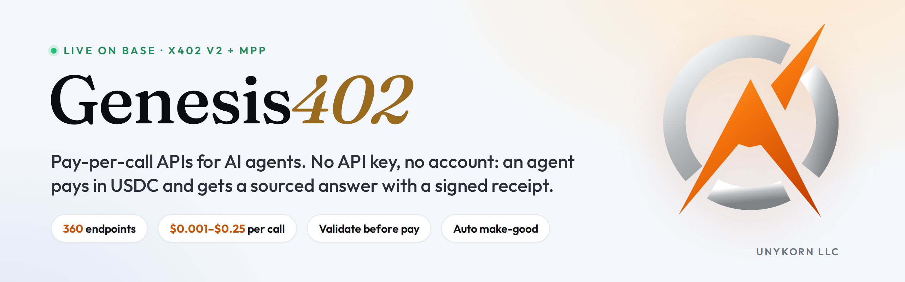

<p align="center">
  
</p>

<p align="center">
  <a href="https://www.npmjs.com/package/genesis402-mcp"></a>
  <a href="https://registry.modelcontextprotocol.io/v0/servers?search=genesis402"></a>
  <a href="https://glama.ai/mcp/connectors/io.github.FTHTrading/genesis402-mcp"></a>
  <a href="https://mcpservers.org/servers/fthtrading/genesis402-agent-kit"></a>
  <a href="https://8004scan.io/agents/base/95721"></a>
  <a href="https://twin.unykorn.org/status"></a>
  <a href="https://discord.gg/qqH42PswDd"></a>
  
</p>

<p align="center">
  <b>Pay-per-call APIs for AI agents over x402 and MPP.</b><br>
  USDC on Base · each call priced and quoted before you pay · no API key · no account.<br>
  Current number of paid routes: <a href="https://twin.unykorn.org/status">live status</a>.<br>
  Every response names its sources and carries an evidence hash. A paid call that is not delivered is re-delivered free on retry.
</p>

<p align="center">
  <a href="https://twin.unykorn.org">Rail</a> ·
  <a href="https://twin.unykorn.org/catalog">Catalog</a> ·
  <a href="https://twin.unykorn.org/status">Live status</a> ·
  <a href="https://twin.unykorn.org/receipts">Receipts</a> ·
  <a href="https://unykorn.ai">UnyKorn</a>
</p>

---

> **Guide:** [Screen a wallet before your agent moves money](docs/guides/screen-a-wallet.md) — $0.008 a check, three ways to call it.
>
> **Community:** [join the UnyKorn Discord](https://discord.gg/qqH42PswDd). Run a free counterparty report with `/check`, watch paid calls settle live in `#rail-feed`, and ask questions in `#help`.

## Quickstart: three steps, under five minutes

Nothing in these three steps costs money. No account, no API key, no wallet.

**1. Connect the hosted MCP endpoint.** Add this URL to any MCP client that speaks streamable HTTP:

```
https://twin.unykorn.org/mcp
```

**2. Make one call.** Run `genesis402_catalog` with the filter `gas`: it is free and lists the matching endpoints with their prices. Then call a paid tool without a payment, for example `genesis402_whois` with `{"domain": "example.com"}`: it answers with the exact price quote (`"mode": "QUOTE_ONLY"`, `"paid": false`) and charges nothing.

**3. Verify a signed receipt.** A paid call is recorded as an Ed25519-signed receipt. The rail publishes one complete sample at [/receipts/sample](https://twin.unykorn.org/receipts/sample) and its public key at [/prove/keys](https://twin.unykorn.org/prove/keys), so you can check a signature on your own machine before you spend anything.

All three steps from a terminal (Node 20 or newer, no dependencies, nothing to install):

```
git clone https://github.com/FTHTrading/genesis402-agent-kit
node genesis402-agent-kit/examples/quickstart.mjs
```

It connects, lists the tools, makes the free catalog call, prints the live quote for one paid tool, then verifies the sample receipt locally and confirms that an altered copy is rejected.

**What costs money.** Only a paid call that you sign. Each endpoint has its own price in USDC; `genesis402_catalog` lists it and the quote states it before anything is signed. The quickstart never pays. To pay, sign the quote with your own wallet (the hosted server holds no keys), or run the local server below with `GENESIS402_LIVE=1` and a cap in `GENESIS402_MAX_USD`. The number of paid routes changes: see [https://twin.unykorn.org/status](https://twin.unykorn.org/status) for the current count.

Then [tell us how it went](#tell-us-how-it-went).

## Ways to connect

### Hosted MCP (nothing to install)

Add this remote to Claude, Cursor, VS Code or any MCP client that speaks streamable HTTP:

```
https://twin.unykorn.org/mcp
```

The hosted server holds no keys. Free tools (`catalog`, `receipt`) work immediately. Paid tools return the exact price quote, or run with a `payment_signature` you produce with your own wallet.

### Local MCP (pays for you, within a cap you set)

```json
{
  "mcpServers": {
    "genesis402": {
      "command": "npx",
      "args": ["-y", "genesis402-mcp"],
      "env": {
        "GENESIS402_LIVE": "1",
        "GENESIS402_PAYER_KEY": "0x<private key of a wallet holding a little USDC on Base>",
        "GENESIS402_MAX_USD": "0.25"
      }
    }
  }
}
```

Without `GENESIS402_LIVE=1` the server is quote-only: it shows the price and signs nothing. The rail sets the price; the client decides whether to accept it. Use a dedicated wallet with a small balance.

### Plain HTTP, any language

**x402**

```
GET https://twin.unykorn.org/price/bitcoin
→ 402, header payment-required: <base64 x402 v2 challenge>
sign the USDC authorization (EIP-3009) for the quoted amount, retry with X-PAYMENT
→ 200 + result + receipt id
```

**MPP** (the `Payment` HTTP auth scheme)

```
GET https://twin.unykorn.org/price/bitcoin
→ 402, header WWW-Authenticate: Payment id="…", method="usdc", intent="charge", request="…"
sign the same EIP-3009 authorization, retry with  Authorization: Payment <base64url credential>
→ 200 + result + Payment-Receipt header
```

Both dialects quote the same price to the same address in the same token. MPP discovery is the standard `/openapi.json` with `x-payment-info` on every operation.

**Free before you pay:** `POST /__validate` checks your parameters with the same validator the paid path uses, so a bad request is never charged.

---

## MCP tools

| Tool | What it does | Cost |
|---|---|---|
| `genesis402_catalog` | Every endpoint with path, price and parameter schema, from the live manifest | Free |
| `genesis402_receipt` | Look up a paid-call receipt by id | Free |
| `genesis402_call` | Call any endpoint on the rail by name | Per endpoint |
| `genesis402_counterparty_report` | Company + registered parents + UN/OFAC/EU/UK sanctions screen, one verdict, signed receipt, branded PDF and public verify page | $0.25 |
| `genesis402_sanctions_name_screen` | One name against the UN, OFAC SDN, EU and UK lists, with list versions cited | $0.02 |
| `genesis402_company_lookup` | Any company worldwide by name, LEI or SEC CIK (GLEIF + SEC EDGAR), with registered parents | $0.01 |
| `genesis402_wallet_brief` | Wallet risk signals: sanctions list, 10-chain scan, activity, summary | Paid |
| `genesis402_token_brief` | Token pre-trade check: metadata, price, holder concentration, verification | Paid |
| `genesis402_screen_sanctions` | Public-data sanctions-list signal for one address | Paid |
| `genesis402_multi_chain_scan` | One address across 10 EVM chains in one call | Paid |
| `genesis402_defi_yields` | Ranked yields from 15,000+ pools, filterable by chain, protocol, token, TVL | Paid |
| `genesis402_market_snapshot` | USD price with 24-hour and 7-day change for the major crypto assets in one call | Paid |
| `genesis402_sec_financials` | As-reported fundamentals for a US public company from SEC XBRL | Paid |
| `genesis402_email_check` | MX, provider, SPF, DMARC, disposable flag, trust score | Paid |
| `genesis402_whois` | Registrar, age, expiry, status and nameservers via RDAP | Paid |
| `genesis402_extract_json` | Extract the fields you name from any text; missing fields are null | Paid |
| `genesis402_web_extract` | Any public page as clean text, title, headings and links | Paid |
| `genesis402_prove` | Signed Ed25519 receipt binding your digest to a settled payment | Paid |
| `genesis402_summarize` | Summarize text as a paragraph, bullets or TL;DR within a word limit | Paid |
| `genesis402_answer_from_text` | Answer one question from your document, with a verified supporting quote | Paid |
| `genesis402_translate` | Translate text into any major language, preserving names, numbers and formatting | Paid |
| `genesis402_paper_search` | Scholarly paper search (OpenAlex) with citation counts and open-access links | Paid |

Live prices come from the rail's manifest; `genesis402_catalog` shows them. Every paid tool returns the receipt id and evidence hash with the result.

## What is on the rail

The number of paid routes changes as routes are added or retired: see [https://twin.unykorn.org/status](https://twin.unykorn.org/status) for the current count. Prices are per endpoint and come from the live catalog.

| Family | Examples |
|---|---|
| Crypto prices | `/price/bitcoin`, `/price/ethereum`, `/price/market-snapshot` |
| DeFi and markets | `/defi/yields`, `/defi/stablecoins`, `/defi/chain/base`, `/defi/fees` |
| Chain reads: EVM chains, BTC, SOL, XLM, XRP | `erc20-balance`, `evm-multi-chain-scan`, `evm-proof`, `xrpl-account`, `stellar-account`, `solana-account`, `btc-utxos` |
| Deterministic compute | hashes, encodings, ABI encode/decode, EIP-712, merkle, ENS |
| Due diligence and risk | `/check/address`, `/wallet-brief`, `/token-brief`, `screen-sanctions`, `/risk` |
| Public records | `/records/sec-financials`, `/records/sec-filings`, `/records/fx-rates`, `/records/treasury-yields`, `/records/vin-decode` |
| Research | `/research/arxiv-search`, `/research/doi`, `/research/npm-package`, `/research/wiki-summary` |
| Web and domain intelligence | `/web/whois`, `/web/dns`, `/web/tls-cert`, `/web/email-check`, `/web-extract`, `/summarize-url` |
| Places, time, weather | `/geo/geocode`, `/geo/weather-forecast`, `/geo/public-holidays` |
| AI text tools | `/v1/chat/completions` (OpenAI-compatible), `/v1/embeddings`, `/ai/extract`, `/ai/text-to-sql`, `/ai/summarize` |
| Proofs | `/prove`, `/json-canonical` |

Full list with schemas and live examples: [catalog](https://twin.unykorn.org/catalog), `/.well-known/x402`, `/openapi.json`.

## Tell us how it went

If you connected the MCP server or called an endpoint, we would like to hear what happened, whether it worked or not.

- **Feedback form:** [five short questions](https://github.com/FTHTrading/genesis402-agent-kit/issues/new?template=feedback.yml). It opens a public GitHub issue, so it needs a GitHub account. We quote nobody unless they choose "Yes" on the form.
- **Something failed:** [report a bug](https://github.com/FTHTrading/genesis402-agent-kit/issues/new?template=bug.yml).
- **Not on GitHub:** write to kevan@unykorn.org.

**On-chain feedback (ERC-8004), for callers who paid.** The seller is registered as agent #95721 in the ERC-8004 Identity Registry on Base. ERC-8004 keeps feedback in a Reputation Registry contract: a wallet records feedback about an agent by calling `giveFeedback` from that wallet, and the standard does not allow the agent's owner or its operators to submit it. [This page](https://twin.unykorn.org/agents/genesis402/feedback) gives the contract address and the parameters for agent #95721; it does not connect to your wallet and sends nothing. The score is yours to choose, and you pay the network fee for that transaction yourself. What is recorded on-chain for this agent can be read at [/agents/genesis402/reputation](https://twin.unykorn.org/agents/genesis402/reputation). The standard: [EIP-8004](https://eips.ethereum.org/EIPS/eip-8004).

**Disclosure.** UnyKorn LLC operates the Genesis402 rail and agent #95721. We do not write feedback about our own agents, and we offer nothing in return for feedback of any kind, favourable or critical.

## What the rail commits to

- **Validate before pay.** Bad input returns 400 with "nothing was charged".
- **Sources on every answer.** Each response lists the upstream it read and an `evidence_hash`. A failed upstream is an error, never a silent zero.
- **Make-good.** A paid call that is not delivered is recorded as owed and re-delivered free on retry; the guardian reconciles every settlement on-chain within 48 hours.
- **Public status.** [twin.unykorn.org/status](https://twin.unykorn.org/status) is the guardian's own report, refreshed every 5 minutes.
- **Identity.** ERC-8004 agent 95721 on Base; A2A card at the rail root.

## Payment rails

x402 v2 `exact` scheme and MPP `usdc`/`charge` (EIP-3009 authorization), on USDC on Base (primary) and Polygon. Solana USDC via facilitator settlement. XRP and USDC on XRPL and Stellar are pay-first, with the payment bound to the challenge nonce. The 402 response lists exactly which lanes are payable right now.

## Repo layout

- `mcp/` — the MCP server (`npx genesis402-mcp`; `genesis402-mcp-http` for hosted mode), `server.json` for the MCP Registry, `smoke.mjs` (13 read-only checks against the live rail).
- `examples/` — `quickstart.mjs`: connect, one free call and one quote, verify a signed receipt. Read-only, no dependencies.
- `docs/` — guides, and `FEEDBACK-IN-PRODUCT.md` (a proposal, not implemented).
- `quickstart/` — Node and Python payers for Base, XRPL and Stellar; `screen.mjs` for the wallet-screening guide.
- `assets/` — brand banner and icon.

---

<p align="center">
  <br>
  <b>Built by <a href="https://unykorn.ai">UnyKorn LLC</a></b> · Wyoming<br>
  <sub>MIT license. Risk and sanctions outputs are heuristic signals from public data, not KYC or a compliance determination. Not financial, legal or tax advice.</sub>
</p>
