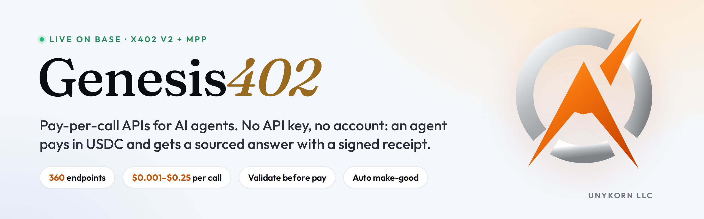

<p align="center">
  
</p>

<p align="center">
  <a href="https://www.npmjs.com/package/genesis402-mcp"></a>
  <a href="https://www.npmjs.com/package/genesis402-mcp"></a>
  <a href="https://github.com/FTHTrading/genesis402-agent-kit/actions/workflows/ci.yml"></a>
  <a href="https://github.com/FTHTrading/genesis402-agent-kit/actions/workflows/release-mcp.yml"></a>
  <a href="https://registry.modelcontextprotocol.io/v0/servers?search=genesis402"></a>
  <a href="https://glama.ai/mcp/connectors/io.github.FTHTrading/genesis402-mcp"></a>
  <a href="https://github.com/FTHTrading/genesis402-agent-kit/blob/main/LICENSE"></a>
</p>

# genesis402-mcp

Genesis402: pay-per-call APIs for AI agents over x402.

This is the MCP server for the [Genesis402](https://twin.unykorn.org) rail: **360 pay-per-call
endpoints** covering DeFi and market data, SEC financials, wallet and token risk signals from
public data, web and domain lookups, AI text tools, and multi-chain reads across EVM chains,
Solana, Bitcoin, Stellar and the XRP Ledger.

Pay only for the call you make: no account, no subscription, no API key.
Prices from $0.001 per call, shown before you pay. This package pays in USDC on Base via x402 v2.

## Quote-only by default

Quote-only by default: nothing is signed or paid until you turn paying on and set a price cap.

Out of the box every paid tool returns the price quote and stops. To enable payment you must
set *both* `GENESIS402_LIVE=1` and `GENESIS402_PAYER_KEY`. Even then, any quote above
`GENESIS402_MAX_USD` (default `$0.25`) is refused rather than paid.

The rail sets the price. This client never does; it only decides whether to accept it.

## Seller identity and receipts

Every call is sold by the Genesis402 rail, **ERC-8004 agent 95721 on Base** (IdentityRegistry
`0x8004A169FB4a3325136EB29fA0ceB6D2e539a432`, registration file
`https://twin.unykorn.org/.well-known/agent-registration.json`, storefront https://genesis402.com).

- The rail names its seller in the 402 challenge and in `/.well-known/x402`. This package passes that block through
  unchanged: every tool result carries `seller` (agent id, registry, chain, pay_to) and `receipts_url`.
- A route sold by a desk agent names that agent (for example 96494 for the dossier) and its own wallet; it is never relabelled.
- If the rail names no seller, the result carries this package's default (agent 95721) with `seller.source` set to `package`
  instead of `rail`. The identity is information only: it never changes a price or a payTo.
- Signed receipts for paid calls are listed at https://twin.unykorn.org/receipts; `genesis402_receipt` fetches one by id.

## Hosted endpoint (no install)

Connect any MCP client that supports streamable HTTP to **https://twin.unykorn.org/mcp**. It
exposes the same 22 tools over every endpoint in the catalog.

- Hosted MCP endpoint at https://twin.unykorn.org/mcp: it holds no keys. A paid tool returns the
  exact x402 quote.
- To pay, sign an x402 v2 payment for that quote with your own wallet (for example `@x402/fetch`
  or a CDP/AgentKit wallet) and call the tool again with `payment_signature`.
- Health check: https://twin.unykorn.org/mcp/health

## Install (local, stdio)

```jsonc
// Claude Desktop: claude_desktop_config.json
// Cursor:         .cursor/mcp.json
{
  "mcpServers": {
    "genesis402": {
      "command": "npx",
      "args": ["-y", "genesis402-mcp"]
    }
  }
}
```

That configuration can browse the catalog and see prices, and cannot spend anything.

To let it pay:

```jsonc
{
  "mcpServers": {
    "genesis402": {
      "command": "npx",
      "args": ["-y", "genesis402-mcp"],
      "env": {
        "GENESIS402_LIVE": "1",
        "GENESIS402_PAYER_KEY": "0x<a funding key you are willing to spend from>",
        "GENESIS402_MAX_USD": "0.05"
      }
    }
  }
}
```

Use a dedicated key holding a few dollars of USDC on Base, never your main wallet.

## Tools (14)

Each paid tool's description carries its live price, read from the rail's
`/.well-known/x402` manifest at startup, so a price change on the rail never leaves this
client advertising a stale number.

| Tool | Cost | What it does |
|---|---|---|
| `genesis402_catalog` | free | Every endpoint with price, title, path and parameters. Call first. |
| `genesis402_receipt` | free | A paid-call receipt by id from the public receipts feed. |
| `genesis402_call` | per endpoint | Call any endpoint in the catalog by name. |
| `genesis402_wallet_brief` | paid | Wallet risk signals in one call: public sanctions-list check, 10-chain scan, activity and summary, with an evidence hash. |
| `genesis402_token_brief` | paid | Token pre-trade check: metadata, price, holder concentration, source verification, sanctions-list signal. |
| `genesis402_screen_sanctions` | paid | Public-data sanctions-list signal: OFAC SDN digital-currency entries and community blocklists. |
| `genesis402_multi_chain_scan` | paid | One call across 10 EVM chains for a single address. |
| `genesis402_defi_yields` | paid | DeFi yields from 15,000+ pools, filterable by chain, protocol, token, stablecoin-only and minimum TVL. |
| `genesis402_market_snapshot` | paid | Price with 24h and 7d change for the major coins, or up to 25 you name, in one call. |
| `genesis402_sec_financials` | paid | As-reported fundamentals for a US public company from SEC XBRL. |
| `genesis402_email_check` | paid | Email/domain deliverability: MX, provider, SPF, DMARC, disposable flag. |
| `genesis402_whois` | paid | Domain registrar, age, expiry, status and nameservers via RDAP. |
| `genesis402_extract_json` | paid | Extract your fields from any text as JSON; missing fields are null, never invented. |
| `genesis402_web_extract` | paid | Any public web page as clean text, title, headings and links. |
| `genesis402_prove` | paid | A signed Ed25519 receipt binding your SHA-256 digest (or text) to a settled payment. |
| `genesis402_summarize` | paid | Summary of text you supply: paragraph, bullets or TL;DR, 20 to 400 words. |
| `genesis402_answer_from_text` | paid | One answer from your document plus a supporting quote the rail verifies is in the text. |
| `genesis402_translate` | paid | Translation into any major language; names, numbers and formatting preserved. |
| `genesis402_paper_search` | paid | OpenAlex scholarly search, by relevance or most-cited, with open-access links. |

## How a paid call works

1. **Free validation.** Parameters go to the rail's free `/__validate` first. Bad input is
   refused before a quote is even requested.
2. **Free quote.** An unpaid request returns the 402 challenge with the price.
3. **Payment**, only in live mode, only under your cap, through the standard x402 v2 client.
4. **Result and receipt.** A signed receipt for every paid call, listed on the rail's public
   [receipts feed](https://twin.unykorn.org/receipts).

One payment buys exactly one execution; re-presenting it returns 409.

## Limits, stated plainly

- Risk and sanctions results are automated heuristic signals from public data. They are not
  KYC, not a compliance determination, and not legal advice. Absence from every list is not a
  clearance.
- `prove` records a claim; it does not evaluate it. The receipt chain is **not externally
  anchored**: a valid receipt shows the rail issued it and has not altered it, not that the
  rail could not have back-dated its own chain.

## Environment

| Variable | Default | Meaning |
|---|---|---|
| `GENESIS402_ORIGIN` | `https://twin.unykorn.org` | Rail origin. |
| `GENESIS402_LIVE` | unset | `1` enables payment. Anything else is quote-only. |
| `GENESIS402_PAYER_KEY` | unset | Private key that funds calls. Required for live mode. |
| `GENESIS402_MAX_USD` | `0.25` | Hard cap per call, checked against the quote and again when signing. Quotes above it are refused; a zero, negative or non-numeric value keeps the server quote-only. |

## Community

Questions, feedback and a free counterparty report (`/check`): [UnyKorn Discord](https://discord.gg/qqH42PswDd).

## Testing

```bash
node smoke.mjs      # read-only checks against the live rail; never pays
node boot-test.mjs  # boots over stdio and lists the tools a client would see
```

UnyKorn LLC (Wyoming). MIT licensed. Changes: [CHANGELOG](https://github.com/FTHTrading/genesis402-agent-kit/blob/main/mcp/CHANGELOG.md).
Discovery: [`/.well-known/x402`](https://twin.unykorn.org/.well-known/x402) ·
Receipts: [`/receipts`](https://twin.unykorn.org/receipts)

## How this rail uses ERC-8004

This section is a reference example: the pattern is small enough to copy. The full write-up, with every URL, is in the rail repository (docs/ERC-8004-REFERENCE.md).

**One collector, eight specialists.** The rail's collecting agent is ERC-8004 #95721 on Base (IdentityRegistry `0x8004A169FB4a3325136EB29fA0ceB6D2e539a432`). Its wallet receives every payment on the 376 treasury-paid routes. Each of those routes is sold by exactly one specialist: `prices`, `chain-reader`, `defi`, `web`, `geo-records`, `research`, `ai-tools` or `utilities`. Five desk routes keep their own desk seller and wallet. Money and identity are separate: `payTo` is never decided by the identity code and is the same on every route as before.

**Where you see it in this server.**
- `seller` on every tool result: the 402's own block when the rail names one (`specialist`, `collector: 95721`, `pay_to`, `card`, `receipts`), else the manifest's `specialist` for the route, else the rail default (labelled `source: "package"`). Until a specialist is registered its `agent_id` is the collector's 95721; afterwards it is the specialist's own id and `collector` stays 95721.
- `genesis402_catalog`: endpoints grouped by specialist, `by_specialist` counts, and a `specialist` argument to list one specialist's routes.
- `genesis402_receipt`: a receipt of a specialist sale names `seller_specialist` and `collector_agent_id`; the result reports that specialist as the seller.

**Cards.** Each agent has a registration file at `https://twin.unykorn.org/agents/<slug>/registration.json` (and by id once registered) listing only services that exist: its routes as `x402` entries, MCP, A2A, x402 discovery, the storefront and the wallet. `registrations` is empty until the agent is registered.

**Validation.** The rail publishes ERC-8004 validations with hashes you can recompute: the first, for #95721, is at https://twin.unykorn.org/validations/g402-2e35434d86f9e31e.json (Validation Registry `0x8004Cc8439f36fd5F9F049D9fF86523Df6dAAB58`). Hash the served request and response documents with keccak256 and compare with the manifest.

**Receipts, activity and badges.** Every paid call returns a signed receipt, public at https://twin.unykorn.org/receipts (per agent: `/receipts?agent=<id-or-slug>`). Per-agent activity, newest first, is at https://twin.unykorn.org/agents (JSON at /agents.json). Wallets we control are labelled internal and are never counted as outside demand. A capability check re-reads each card's claims every 10 minutes without spending money, and the `?variant=verified` badge is green only when every checkable claim passed recently.

To copy the pattern: one wallet collects; name a seller per product family in the 402 and in the signed receipt; serve cards only for what exists; pin `accepts[]` with a golden test; count per seller from the receipts ledger so the collector's figure is the sum and nothing is counted twice.
