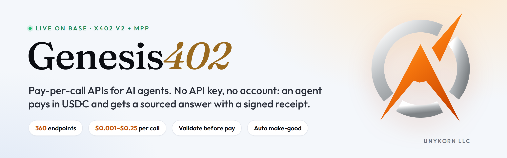

<p align="center">
  
</p>

<p align="center">
  <a href="https://www.npmjs.com/package/genesis402-mcp"></a>
  <a href="https://www.npmjs.com/package/genesis402-mcp"></a>
  <a href="https://github.com/FTHTrading/genesis402-agent-kit/actions/workflows/ci.yml"></a>
  <a href="https://github.com/FTHTrading/genesis402-agent-kit/actions/workflows/release-mcp.yml"></a>
  <a href="https://registry.modelcontextprotocol.io/v0/servers?search=genesis402"></a>
  <a href="https://glama.ai/mcp/connectors/io.github.FTHTrading/genesis402-mcp"></a>
  <a href="https://github.com/FTHTrading/genesis402-agent-kit/blob/main/LICENSE"></a>
</p>

# genesis402-mcp

Genesis402: pay-per-call APIs for AI agents over x402.

This is the MCP server for the [Genesis402](https://twin.unykorn.org) rail: **360+ pay-per-call
endpoints** covering DeFi and market data, SEC financials, wallet and token risk signals from
public data, web and domain lookups, AI text tools, and multi-chain reads across EVM chains,
Solana, Bitcoin, Stellar and the XRP Ledger. It also carries tools for UnyKorn's
[btc402](https://btc402.genesis402.com) Bitcoin node API (block height and fee estimate, each
response carrying an Ed25519-signed attestation).

Pay only for the call you make: no account, no subscription, no API key.
Prices from $0.001 per call, shown before you pay. This package pays in USDC on Base via x402 v2.

## Quote-only by default

Quote-only by default: nothing is signed or paid until you turn paying on and set a price cap.

Out of the box every paid tool returns the price quote and stops. To enable payment you must
set *both* `GENESIS402_LIVE=1` and `GENESIS402_PAYER_KEY`. Even then, any quote above
`GENESIS402_MAX_USD` (default `$0.25`) is refused rather than paid.

The rail sets the price. This client never does; it only decides whether to accept it.

## Hosted endpoint (no install)

Connect any MCP client that supports streamable HTTP to **https://twin.unykorn.org/mcp**. It
exposes the same 26 tools over every endpoint in the catalog.

- Hosted MCP endpoint at https://twin.unykorn.org/mcp: it holds no keys. A paid tool returns the
  exact x402 quote.
- To pay, sign an x402 v2 payment for that quote with your own wallet (for example `@x402/fetch`
  or a CDP/AgentKit wallet) and call the tool again with `payment_signature`.
- Health check: https://twin.unykorn.org/mcp/health

## Install (local, stdio)

```jsonc
// Claude Desktop: claude_desktop_config.json
// Cursor:         .cursor/mcp.json
{
  "mcpServers": {
    "genesis402": {
      "command": "npx",
      "args": ["-y", "genesis402-mcp"]
    }
  }
}
```

That configuration can browse the catalog and see prices, and cannot spend anything.

To let it pay:

```jsonc
{
  "mcpServers": {
    "genesis402": {
      "command": "npx",
      "args": ["-y", "genesis402-mcp"],
      "env": {
        "GENESIS402_LIVE": "1",
        "GENESIS402_PAYER_KEY": "0x<a funding key you are willing to spend from>",
        "GENESIS402_MAX_USD": "0.05"
      }
    }
  }
}
```

Use a dedicated key holding a few dollars of USDC on Base, never your main wallet.

## Tools (26)

Each paid tool's description carries its live price, read from the rail's
`/.well-known/x402` manifest at startup, so a price change on the rail never leaves this
client advertising a stale number.

| Tool | Cost | What it does |
|---|---|---|
| `genesis402_catalog` | free | Every endpoint with price, title, path and parameters. Call first. |
| `genesis402_receipt` | free | A paid-call receipt by id from the public receipts feed. |
| `genesis402_call` | per endpoint | Call any endpoint in the catalog by name. |
| `genesis402_counterparty_report` | paid | One company before you deal with it: registered entity, parents, UN/OFAC/EU/UK screening, verdict and signed receipt. |
| `genesis402_sanctions_name_screen` | paid | One person or organisation name against the UN, US OFAC SDN, EU and UK consolidated lists. |
| `genesis402_company_lookup` | paid | One company in the official registers (GLEIF, SEC EDGAR). |
| `genesis402_wallet_brief` | paid | Wallet risk signals in one call: public sanctions-list check, 10-chain scan, activity and summary, with an evidence hash. |
| `genesis402_token_brief` | paid | Token pre-trade check: metadata, price, holder concentration, source verification, sanctions-list signal. |
| `genesis402_screen_sanctions` | paid | Public-data sanctions-list signal: OFAC SDN digital-currency entries and community blocklists. |
| `genesis402_multi_chain_scan` | paid | One call across 10 EVM chains for a single address. |
| `genesis402_defi_yields` | paid | DeFi yields from 15,000+ pools, filterable by chain, protocol, token, stablecoin-only and minimum TVL. |
| `genesis402_market_snapshot` | paid | Price with 24h and 7d change for the major coins, or up to 25 you name, in one call. |
| `genesis402_sec_financials` | paid | As-reported fundamentals for a US public company from SEC XBRL. |
| `genesis402_email_check` | paid | Email/domain deliverability: MX, provider, SPF, DMARC, disposable flag. |
| `genesis402_whois` | paid | Domain registrar, age, expiry, status and nameservers via RDAP. |
| `genesis402_extract_json` | paid | Extract your fields from any text as JSON; missing fields are null, never invented. |
| `genesis402_web_extract` | paid | Any public web page as clean text, title, headings and links. |
| `genesis402_prove` | paid | A signed Ed25519 receipt binding your SHA-256 digest (or text) to a settled payment. |
| `genesis402_summarize` | paid | Summary of text you supply: paragraph, bullets or TL;DR, 20 to 400 words. |
| `genesis402_answer_from_text` | paid | One answer from your document plus a supporting quote the rail verifies is in the text. |
| `genesis402_translate` | paid | Translation into any major language; names, numbers and formatting preserved. |
| `genesis402_paper_search` | paid | OpenAlex scholarly search, by relevance or most-cited, with open-access links. |
| `genesis402_btc402_quote` | free | Live x402 v2 quote for a btc402 route (`/blockcount` or `/feeestimate`), decoded from its `PAYMENT-REQUIRED` header. |
| `genesis402_btc402_verify_attestation` | free | Checks a btc402 attestation by digest with the open [btc402-verify](https://github.com/FTHTrading/btc402-verify) code: digest, published key, Ed25519 signature and the Base USDC transfer. Each check is PASS, FAIL or UNAVAILABLE. |
| `genesis402_btc402_blockcount` | paid | Current Bitcoin mainnet block height from btc402, with a signed attestation. |
| `genesis402_btc402_feeestimate` | paid | Bitcoin fee estimate (BTC/kvB, confirmation within 6 blocks) from btc402, with a signed attestation. |

The btc402 tools call `https://btc402.genesis402.com` directly rather than the rail. Their price
comes from the gate's live 402 quote ($0.003 USDC on Base per call at the time of writing; the
quote is the source). They pay the same way as every other paid tool: quote first, then a
`payment_signature` you signed, or a local payer under `GENESIS402_MAX_USD`. You can also pay
btc402 with any x402 v2 client and no MCP at all.

## How a paid call works

1. **Free validation.** Parameters go to the rail's free `/__validate` first. Bad input is
   refused before a quote is even requested.
2. **Free quote.** An unpaid request returns the 402 challenge with the price.
3. **Payment**, only in live mode, only under your cap, through the standard x402 v2 client.
4. **Result and receipt.** A signed receipt for every paid call, listed on the rail's public
   [receipts feed](https://twin.unykorn.org/receipts).

One payment buys exactly one execution; re-presenting it returns 409.

## Limits, stated plainly

- Risk and sanctions results are automated heuristic signals from public data. They are not
  KYC, not a compliance determination, and not legal advice. Absence from every list is not a
  clearance.
- A btc402 `VERIFIED` result shows the record was issued by the btc402 service key, has not
  been changed since, and matches its Base USDC transfer. It is not an on-chain registry entry,
  an external timestamp or a third-party audit. Records issued before Ed25519 signing began
  carry no signature and come back `NOT VERIFIED`.
- `prove` records a claim; it does not evaluate it. The receipt chain is **not externally
  anchored**: a valid receipt shows the rail issued it and has not altered it, not that the
  rail could not have back-dated its own chain.

## Environment

| Variable | Default | Meaning |
|---|---|---|
| `GENESIS402_ORIGIN` | `https://twin.unykorn.org` | Rail origin. |
| `GENESIS402_LIVE` | unset | `1` enables payment. Anything else is quote-only. |
| `GENESIS402_PAYER_KEY` | unset | Private key that funds calls. Required for live mode. |
| `BTC402_ORIGIN` | `https://btc402.genesis402.com` | btc402 gate origin for the `genesis402_btc402_*` tools. |
| `BTC402_BASE_RPC` | `https://mainnet.base.org` | Public Base RPC used to read the attestation's USDC transfer. |
| `GENESIS402_MAX_USD` | `0.25` | Hard cap per call, checked against the quote and again when signing. Quotes above it are refused; a zero, negative or non-numeric value keeps the server quote-only. |

## Community

Questions, feedback and a free counterparty report (`/check`): [UnyKorn Discord](https://discord.gg/qqH42PswDd).

## Testing

```bash
node --test test/btc402.test.mjs  # offline: btc402 tools against stubs, nothing leaves the machine
node smoke.mjs      # read-only checks against the live rail; never pays
node boot-test.mjs  # boots over stdio and lists the tools a client would see
```

UnyKorn LLC (Wyoming). MIT licensed. Changes: [CHANGELOG](https://github.com/FTHTrading/genesis402-agent-kit/blob/main/mcp/CHANGELOG.md).
Discovery: [`/.well-known/x402`](https://twin.unykorn.org/.well-known/x402) ·
Receipts: [`/receipts`](https://twin.unykorn.org/receipts)
